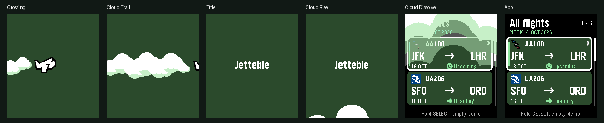
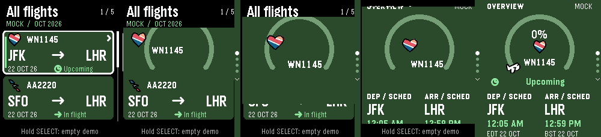

# Jetebble 0.7.10 — merged release verification

This update combines the approved stretch/card-focus prototype `ece1b4f` with
the latest main `86d4738`, including the 0.7.9 rising-cloud intro (`d26fd0d`)
and the CloudPebble archive fix. Merge commit `bf6a359` retains both histories.

The startup implementation, `.gitattributes` and archive-check script are
byte-for-byte identical to that main revision. Flight data, phone settings,
resources and the production UUID are retained. Version metadata is **0.7.10**.

## Build and integration

The first combined build exceeded the SDK's 65,535-byte virtual-image limit at
66,260 bytes. The bounded launcher schedule now allocates its existing storage
once on the heap rather than reserving a static copy in the app image. Its
11-slice capacity, field lengths and behavior are unchanged. The buffer is reused
and released at shutdown. An allocation failure keeps the OS's existing subtitle
and retries on the next update. No flight fields or visual effects were removed.

The final live configuration and both emulator previews compile with SDK
**4.33.1 / Pebble Tool 5.0.40** for **Emery / Pebble Time 2**. The SDK reports a
**64,605-byte static RAM footprint**, **66,467 bytes** initial heap before runtime
allocations, and **16,487 bytes** of resources. The injected virtual-image size
is recorded separately in `release-0.7.10/production-build.json`; it passes the
SDK's 16-bit limit. The existing RWX-segment linker warning remains.

`build/jetebble-0.7.10.pbw` and the canonical `build/pebble-flight.pbw` are
byte-for-byte identical. Embedded metadata confirms Jetebble, version 0.7.10,
SDK metadata 3, Emery and UUID `e6fc90f6-5f5a-4f34-a18e-76f13a5b2327`.
Mock data and startup-review controls are off; the normal phone companion is
included and the approved stretch profile is on.

## Checks performed

- All **13 suites** in `scripts/test.sh` pass. The added launcher ownership test
  covers allocation failure/retry, reuse under memory pressure, unchanged
  subtitles, invalid/duplicate input, OS slice limits, delayed callbacks and
  repeated cleanup. Existing five-flight, time-format, API mapping/race, native
  snapshot, navigation and vector-ownership checks continue to pass.
- **17 startup emulator checks** pass with the merged app: native plane movement,
  title hold, rising clouds, native alpha handoff, stable flight-list endpoint,
  all four skip buttons during flight and cloud exit, and returning from a
  detail without replaying the intro.
- **26 motion emulator checks** pass with the merged app: explicit preview
  launch, both card positions, focus in both directions, all detail pages,
  boundaries, notes, reverse motion, rapid input, held scrolling, fifth-flight
  and empty-list restoration, exit during motion, and constant settled heap
  across 25 consecutive open/back cycles.
- **16 resting screenshots** exactly match the approved 0.7.8 endpoints. The
  animations change motion while preserving the static layouts.
- The final GitHub-format source archive is checked using the preserved
  `scripts/check-cloudpebble-archive.py`. All source/resources, manifest media,
  Markdown guides and licenses are verified byte-for-byte. Generated captures
  remain in GitHub and are omitted from the import archive under the retained
  export rules, keeping the project below CloudPebble's 400-file limit.

The source-archive result and bundle hashes are recorded alongside the actual
native captures under `docs/release-0.7.10/`. These are real QEMU screenshots,
not rendered approximations. No credentials or paid provider calls were used.




## Install the latest build

In CloudPebble, pull **`main`** from `kvnsr1/pebble-flight`. Keep **Pebble C SDK**,
SDK metadata **3**, target **Emery / Pebble Time 2**, and the imported production
UUID and message keys. Compile, confirm **0.7.10**, then choose **Build & Run →
Phone** to update the watch, or run on Emery to preview.

To reproduce locally:

```sh
sh scripts/test.sh
python3 scripts/build-startup-preview.py --production-check
python3 scripts/check-cloudpebble-archive.py --output build/jetebble-0.7.10-source.zip
```

Physical-watch timing/battery, authenticated CloudPebble compilation and
credentialed live service behavior were not tested in this release verification.
Live packets during a stretch transition were not exercised; the existing
data-change cancellation path is retained. No appstore release is part of this
source update.
