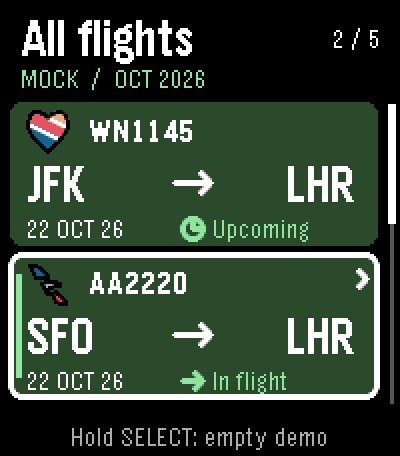
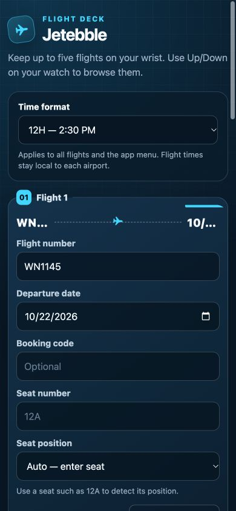
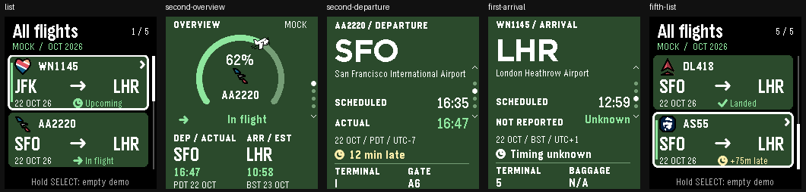
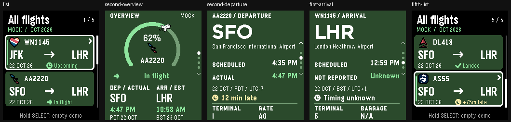

# Five flights, clock format and larger cards

Jetebble **0.7.8**, review branch **`codex/five-flights-time-format`**, based on
main `3484d46` (0.7.7). This update keeps the native C / PebbleKit JS architecture,
SDK 3 metadata, Emery (200×228) target, production UUID and live-data default.
No appstore release is part of this work.



## Cards and motion

Two 184×72 px rounded green cards appear at once, with 4 px separation. Each
shows the existing 25 px airline PDC and flight number, a bold Gothic 28 route,
then date and operational status. Unknown carrier logos use the existing plane.
The selected card has a white border, green stripe and chevron. The scrollbar
and position/count remain visible. All flights, including landed flights, remain
available until removed in phone settings.

Select expands the selected card into Overview over **320 ms**. The airline logo
travels from its eyebrow position to the existing Overview logo position. The
flight number moves with it, first clearing the logo vertically, then centering
below it. The two elements never overlap. Cubic ease-out and exact integer end
coordinates avoid a jump at handoff. Back from Overview reverses the same path.
Back from another detail page retains the existing card-collapse behavior.

The prior 110 ms selection, 190 ms detail-page and 150 ms note transitions remain.
Progress uses actual model values; the transition does not change flight progress.
Buttons interrupt immediately. Data changes, loss of visibility and allocation
failure retain the existing cancellation/fallback paths. Airline PDCs are retained
in a bounded five-entry cache so drawing the list does not decode each logo again
on every animation frame. No new art or font resources were added.

This follows [the supplied motion guide](PEBBLE_MOTION_GUIDE.md): short,
event-triggered native animation, reusable vector resources and actual emulator
captures. Timing, battery life and display response on a physical watch remain
to be verified.

## Phone settings

Add up to five flight numbers and airport-local departure dates. Booking and
seat fields keep their previous behavior. Clear flight details removes that
slot when saved. **Time format** is one preference for all flights:

- **24H:** `00:05`, `12:59`, `16:47` (default).
- **12H:** `12:05 AM`, `12:59 PM`, `4:47 PM`.

The choice persists in phone storage. It applies to Overview, scheduled and
estimated/actual detail times, update/next-refresh labels and the launcher
subtitle. Airport-local dates, timezone abbreviations, UTC offsets, delays and
unknown/unavailable field meanings do not change. The update timestamp remains
the time of the successful lookup; a display change does not mark data fresh.
Changing only the format re-renders all cached flights without a provider call.
The active flight is preserved when the flight configuration is unchanged.



The current settings page enables five slots only when the installed companion
advertises the new preference. Older companions see three slots and an upgrade
message. The new companion also rejects an old cached three-slot response that
would silently remove saved flights four and five. Its settings URL has a 0.7.8
cache-busting parameter. Existing flights, keys, cache and booking storage keys
are retained.

## Review in CloudPebble

1. Import GitHub repository `kvnsr1/pebble-flight`, branch
   **`codex/five-flights-time-format`**, or pull that branch in a separate review
   project. Use **Pebble C SDK**, SDK metadata **3**, target **Emery / Pebble Time 2**.
2. Build & Run → Emulator → Emery previews the normal app. Normal source uses
   live data and the production identity; opening it requires phone data for
   populated flight screens.
3. For credential-free review, import one of the separately generated source
   ZIPs below into a new Pebble C SDK project and run on Emery. These use the
   separate **Jetebble Review** UUID `b8c70788-473f-4d58-8b65-a772fa1cb09b`,
   mock mode and an inert phone companion. They cannot update live flights.

The normal build still opens the existing GitHub Pages settings URL. Until
this update is approved for `main` and GitHub Pages deploys it, that hosted page
still has the old three-slot controls. Use the isolated preview ZIPs to review
the watch UI and the local `config/index.html` preview for the new settings.

Generate isolated review files using the installed local SDK:

```sh
python3 scripts/build-settings-cards-review.py --format 24H
python3 scripts/build-settings-cards-review.py --format 12H
python3 scripts/build-settings-cards-review.py --production
```

Outputs in `build/`:

- `jetebble-review-24h-source.zip` / `jetebble-review-24h.pbw`
- `jetebble-review-12h-source.zip` / `jetebble-review-12h.pbw`
- `jetebble-0.7.8.pbw` (normal live configuration and identity)

The builder copies tracked app files only. Fixture
`test/fixtures/settings_review_flights.js` uses the production JS formatter to
generate deterministic native mock data. The two preview apps share a review
UUID, so installing one replaces the other. They coexist with production
Jetebble. No credentials are included. These are synthetic examples, not real
airline schedules or bookings:

| Position | Example | What to inspect |
|---|---|---|
| 1 | WN1145, upcoming JFK → LHR | Midnight, different timezones, long JFK name, unknown gate, N/A baggage |
| 2 | AA2220, airborne SFO → LHR | 62%, actual/estimated times, overnight arrival, shared header from second card |
| 3 | UA206, boarding | Scrolling selection and status |
| 4 | DL418, landed | 100%, retained logged flight |
| 5 | AS55, delayed | Noon, 75 min late, unknown gate, fifth-flight scrolling |

Up/Down selects flights; Select opens Overview. Up/Down moves through Overview,
Departure, Arrival, Booking and stops at either end. Select on a detail toggles
the information note. Back returns to the list preserving selection and scroll.
Hold Select on the list toggles the empty demo. Any button skips the startup
intro and consumes that press. The standard six-scenario mock mode, including
cancellation, also remains available via `PEBBLE_MOCK_DATA=1` in the main source;
see the README. Restore `0` for live builds.

## Validation, October 21, 2026

- All **11 suites** in `scripts/test.sh` pass: provider mapping, settings save and
  compatibility, native handshake, scenarios/navigation, motion geometry,
  timezone/DST, phone sync/races/errors, launcher planning/parser and native store.
  Tests cover all five cached flights, atomic five-packet commits, preference
  persistence, original update timestamps, selected fifth flight, no provider
  request for a format-only save and old-page data-loss protection.
- The normal live configuration and both isolated previews compile for Emery
  with **SDK 4.33.1 / Pebble Tool 5.0.40**. Production resource size is **16,487 B**,
  static RAM footprint **62,037 B**, available heap **69,035 B** before runtime
  allocations. The toolchain reports its existing RWX segment linker warning;
  builds complete successfully.
- Actual Emery QEMU screenshots and **17 checks per format** were captured with
  `scripts/review-settings-cards.py`. They cover first/last boundaries, four
  detail pages, Select note toggle, first/second-card shared motion, reverse
  motion, still Overview, rapid input, fifth-flight scroll restoration and
  empty/restored list. Intermediate frames are recorded as GIFs and storyboards.
  Captures use the SDK's standard color correction. Inspection found no clipping
  of the tested clock strings, cards or long airport names.
- The real settings page was reviewed in a **390×844** local browser: five
  editable cards, both format choices, valid filled form, clearing/re-entering
  flight five without altering flight one or the preference, and no horizontal
  page overflow. Serialization/return-to-companion behavior is tested in the
  DOM harness; no phone settings were changed in this browser review.




Raw evidence: `settings-cards/24h/validation.json`,
`settings-cards/12h/validation.json`, screenshots and frame strips in those folders.
No paid API requests, authenticated CloudPebble session or physical-watch
installation was used. Before using on a watch, build the normal configuration,
install through Developer Connection, reopen phone settings, save five flights
and toggle 12H/24H. Verify synchronization, launcher subtitle and cached/offline
behavior on the phone/watch pair. CloudPebble import/build itself still needs
verification in your account.
