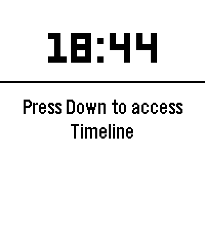

# Jetteble startup animation

Approved for Jetebble **0.7.7**, based on the 0.7.6 source.
The animation uses the title **Jetteble**, exactly as requested;
the existing app/launcher name remains Jetebble.



## Sequence

- 0–1.3 seconds: the supplied 50×50 white/black vector plane flies left to right,
  with a gentle 4 px climb, trailing rounded clouds.
- 1.45–2.61 seconds: individual puffs drift upward/downward and shrink at
  staggered times, revealing the title behind them.
- From 1.78 seconds: **Jetteble** settles into place in native
  `FONT_KEY_GOTHIC_28_BOLD`, the font used by the app's page headings.
- 2.61–3.3 seconds: the title holds still, then the existing app appears.

Background: the app's native dark green. Clouds: white with a mint underside.
Rendering uses native circles and the existing PDC plane; no raster frame
sequence, extra font resource, or new bundled artwork is required.

## App behavior

The intro runs once when the app opens. Any button skips it and consumes that
press, so it does not navigate a hidden screen. Data initialization continues
under the overlay. Leaving the window cancels the intro; returning to the list
does not replay it. The animation stops drawing during the final title hold,
and the temporary plane resource is released on completion or skip.

`src/c/prototype/startup.c` owns rendering and lifecycle. The approved native UI
calls it at launch and dismisses it on navigation or window disappearance.
The optional legacy renderer is unchanged.

## Offline review package

Build locally using the existing SDK:

```sh
python3 scripts/build-startup-preview.py
```

Outputs:

- `build/jetteble-startup-preview.pbw`
- `build/jetteble-startup-preview-source.zip`

The review app is **Jetteble Intro**, UUID
`b7c506bc-0cf8-4e02-83e6-a09a3a0ff8aa`, for Emery / Pebble Time 2 (200×228).
It has frozen mock flights and an inert phone companion. Hold Select on All
Flights to replay the intro. There are no credentials, settings, or provider
requests in the review app. The normal source retains its production identity
and live configuration.

The packaging script copies tracked app files and the startup module into an
isolated build folder. It excludes unrelated untracked duplicate files. A
normal live-configuration compile can be checked without installing it:

```sh
python3 scripts/build-startup-preview.py --production-check
```

## Verified locally

- Offline preview and normal live configuration compile with SDK 4.33.1.
- The repository's complete `scripts/test.sh` suite passes.
- `scripts/review-startup.py` captures actual Emery QEMU framebuffers and passes
  nine checks: intermediate frames, measured left-to-right plane movement,
  still title hold, idle app handoff, all four skip buttons, and return from a
  flight without replay.
- `docs/startup/validation.json` records results. `startup.gif` shows the intro
  through its title hold; `storyboard.png` also shows the handoff to the app.
- Repository integration was approved after the local preview. No appstore
  release or physical-watch installation was performed. Physical-watch timing
  and battery remain untested.

See [Pebble motion resources and build guidelines](PEBBLE_MOTION_GUIDE.md) for the
research, tool links, and workflow used to develop this animation.
