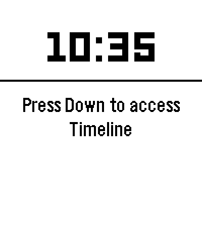

# Startup cloud transition — Jetebble 0.7.9

Approved for integration into `main` on October 21, 2026, based on Jetebble 0.7.8.
The existing plane flight, cloud trail, and **Jetteble** title are retained.
This revision changes the final handoff into the app.

## Motion

- The original plane flight and title reveal run first.
- At 2.85 seconds, a center-led set of rounded clouds begins rising from below
  the screen. Slightly different release times, sizes, and sideways drift make
  the lift feel buoyant and energetic.
- The cloud front passes over the title. A soft trailing edge fades over the
  actual flight list, progressively revealing the app from the bottom.
- By the end of the four-second sequence, the overlay is fully transparent.
  Removing it leaves the exact same app frame, avoiding a final visual cut.

Colors remain native dark green, white, and mint. The fade uses the panel's real
alpha levels without a dither pattern. The type stays in Pebble Gothic 28 Bold.

## Implementation

`src/c/prototype/startup.c` captures its settled title composition once into a
temporary 4-bit palette bitmap (about 23 KB at 200×228). The cloud envelope and
alpha are then updated on this surface and composited using `GCompOpSet`.
The root layer is redrawn underneath, so the transition reveals current app
content rather than a mock image or a frozen copy of the flight list.

The bitmap is freed on completion, skip, or loss of visibility. Allocation or
framebuffer-capture failure skips the ending safely. The existing any-button
skip behavior remains, and returning to the list does not replay the intro.

## Local review

Build the isolated offline preview with `python3 scripts/build-startup-preview.py`.
It retains its separate review UUID and inert companion. Hold Select on All
Flights to replay. The builder now clears generated staging output so message
keys from older app versions cannot leak into the new build.

Artifacts:

- `build/jetteble-startup-preview.pbw`
- `build/jetteble-startup-preview-source.zip`
- [Emulator storyboard](startup-cloud-transition/storyboard.png)
- [Capture and interaction checks](startup-cloud-transition/validation.json)
- [0.7.9 production bundle identity and build record](startup-cloud-transition/production-build.json)

Build the normal app with `python3 scripts/build-startup-preview.py --production-check`.
This produces `build/jetebble-0.7.9.pbw` and `build/pebble-flight.pbw`, retaining
the production UUID, live companion, five saved flights, clock-format setting,
and native card transitions. Install this bundle for the normal app; the isolated
startup preview is only for offline animation review.

The native preview and normal live configuration compile for Emery with SDK
4.33.1. The existing repository test suite passes. The review script checks title
continuity, upward cloud movement, progressive app reveal, exact final-frame
continuity, all four buttons during both flight and exit, and return navigation.
All 17 recorded emulator checks pass.
The normal build is compiled only; no live provider requests are made for review.

The repository update is authorized for `main`. No appstore release or
physical-watch installation is part of this update. Hardware timing and battery
remain untested.
