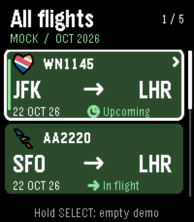

# Stretch motion — Jetebble 0.7.10

Approved for **main** in Jetebble **0.7.10**. The reviewed motion from
`codex/stretch-flight-motion` is merged with main `86d4738`, retaining the 0.7.9
rising-cloud startup and CloudPebble archive fix. Native C, SDK 3 metadata and
Emery 200×228 remain unchanged. See [the combined release verification](RELEASE_0.7.10.md).
No appstore release is included.

## Motion specification

| Trigger | Behavior | Duration and handoff |
|---|---|---|
| Select a flight | Shared airline logo travels to Overview, grows 25→35→25 px, with a four-band vector ripple. The number follows, scales up to 112%, then centers below it. | 420 ms; exact original resting positions and fonts. |
| Back from Overview | Reverse shared path, with the opposite leading edge in the vector ripple. | 420 ms; exact selected card and scroll restored. |
| Up/Down between flights | Outgoing logo briefly recedes to 22 px; incoming logo lifts 2 px and grows to 29 px. Text follows at 95% / 108%. The destination card expands 2 px at each side, while the green focus stripe travels to it. | 280 ms; incoming effect starts after 28 ms, outgoing starts immediately. Both settle at the existing 25 px logo / 18 px font. |

The card-focus treatment is the best homescreen opportunity: it communicates
which existing flight receives focus, with a smaller version of the opening
effect. Routes, dates and status remain readable. A moving full-card white
rectangle was avoided because it crossed the routes while traveling between
cards; the stripe carries that movement instead.

All motion is event-triggered and stops at rest. There is no idle loop. Page
slides, notes, Booking, operational status and the actual flight-progress values
retain their existing behavior. The progress marker appears at the final shared
header handoff, so an upcoming flight opened from the lower card cannot collide
with the airline logo crossing the left side of the ring. Destination labels
are staged behind the shared header. This is decorative navigation motion;
the plane never advances flight progress to make the transition look lively.




## Rendering and lifecycle

The implementation adapts the supplied [stretch guide](PEBBLE_STRETCH_GUIDE.md)
and [general motion guide](PEBBLE_MOTION_GUIDE.md). It uses the documented
[native draw-command APIs](https://developer.rebble.io/docs/c/Graphics/Draw_Commands/)
and installed SDK headers; no Dribble implementation or artwork was copied.

- Existing airline PDCs are cloned during transition preparation. Shared cached
  images remain immutable. Each point is transformed from its saved original
  coordinate, preserving precise-path 13.3 coordinates, colors, path closure,
  circles and outline weight. There is no accumulated point drift.
- Four bands use the original Y coordinate, reversed for Up/Back. Internal lag
  is limited to 3 px to preserve each carrier's identity. Band starts are 23 ms
  apart during opening (15 ms during card focus). Every band finishes before
  the master timeline completes; there is no early disposal.
- The number uses the existing native Gothic 18 Bold pixels. A small temporary
  mask enables whole-text scaling without distorting individual glyphs. Scratch
  pixels are saved and restored within the same render callback, so they never
  appear on screen. The permanent resting text is drawn normally by the SDK.
- At most two icon copies and two label masks participate. Commands/points are
  capped at 128 / 2048 per icon. Allocation and resource decoding happen during
  preparation, not every frame; the original masks/points are reused.
- A new button press cancels the current transition, settles on its authoritative
  selected flight and immediately handles the latest action. Held buttons keep
  the established 180 ms repeat interval. Inputs never form a delayed queue.
- Data changes and window disappearance use the existing cancellation path.
  Completion, interruption and partial-allocation failure all free temporary
  resources. Missing artwork keeps the neutral plane; failed motion resources
  use ordinary text and an unscaled logo. Failure to allocate the animation
  itself leaves a valid static destination.

Tune the profile in `src/c/prototype/motion.h`. The whole effect can be simplified
by setting **`PEBBLE_STRETCH_MOTION=0`** in `prototype_config.h`; this retains
ordinary translation, with the previous 110 ms focus / 320 ms opening durations.
It is a compile-time review option, not a new phone preference.

## CloudPebble review

For the approved live app, pull **main** from `kvnsr1/pebble-flight` into your
linked CloudPebble project. Keep **Pebble C SDK**, **SDK metadata 3** and **Emery /
Pebble Time 2**. Compile, verify version **0.7.10**, then run on Emery or install
through **Build & Run → Phone**.

The optional `build/jetebble-stretch-12h-source.zip` remains available for offline
review in a separate Pebble C SDK project.

The separate **Jetebble Motion** UUID is
`b9d81999-5940-4b69-9c76-b883fb2dc10c`. Mock mode is enabled and the companion is
inert. It has five deterministic synthetic flights, with no credentials or live
requests. The 12H fixture uses the production clock formatter. These fixtures
are examples, not airline schedules or bookings. All review variants share the
review UUID and replace each other; they coexist with the production app.

Use Up/Down to focus a flight, Select to open it, Back to return. Details remain
Overview → Departure → Arrival → Booking. Select on details toggles its data
note. Hold Select on the list toggles empty/restored data. Any button skips the
existing startup intro. Try opening both the upper and lower card, and press
Up/Down or Back rapidly to interrupt the effect.

Build scripts (with the installed Pebble tools on PATH):

```sh
npm ci
python3 scripts/build-stretch-preview.py --format 12H
python3 scripts/build-stretch-preview.py --simple --format 12H
python3 scripts/build-stretch-preview.py --missing-icon --format 12H
python3 scripts/build-stretch-preview.py --production
```

The first command generates the review `.pbw` and source `.zip`. The next two
generate `jetebble-stretch-simple` and `jetebble-stretch-missing` variants. Missing
artwork uses synthetic flight ZZ42 in slot five. `--production` only compiles the
normal live configuration, preserving its UUID and live default; its output is
`jetebble-stretch-production-check.pbw`. It does not install or publish it.

## Original prototype validation

The following records the isolated review before merging the 0.7.9 startup.
Combined 0.7.10 checks are recorded in [the release verification](RELEASE_0.7.10.md).

Validated locally on October 21, 2026 with **SDK 4.33.1 / Pebble Tool 5.0.40**.

- The normal live configuration, full motion preview, simple profile and
  missing-logo profile compile for Emery. The live image is **64,981 B** against
  the SDK's **65,535 B** virtual-image limit, with **66,091 B** initial free heap
  before runtime allocations. Resources remain **16,487 B**. Recheck image size
  when combining further work; the binary margin is small. The SDK emits its
  existing RWX segment linker warning; compilation succeeds.
- All **12 suites** in `scripts/test.sh` pass. The new vector test covers immutable
  source images, precise and negative coordinates, exact reset, circles/styles,
  invalid bounds, point limits, repeated ownership cleanup and failure at each
  of the three allocation stages. Geometry tests cover scale limits, band
  endpoints and separated header bounds throughout both card paths.
- **42 native emulator checks** pass. Actual Emery frames capture opening from both card positions, reverse motion,
  both focus directions, all four detail pages, boundaries, rapid presses, held
  scrolling, fifth-flight restoration, empty/restored data and exiting during
  motion. The complete review includes 25 consecutive open/back cycles with
  native free-heap telemetry; the settled reading is constant across the cycles.
  The final preview records **105,936 B free** at each of those settled checkpoints.
- The simpler profile and unsupported-logo variant are also exercised in the
  emulator, including exit during animation and re-entry. Comparison against
  the normal resting images confirms that the static layout is preserved.
  **16 resting screenshots** exactly match the approved 0.7.8 images at `36c1be6`;
  the comparison record is `stretch-motion/resting-layouts.json`.

Native evidence and check counts are recorded in `stretch-motion/12h/validation.json`
and each fallback/re-entry folder, alongside the original GIFs and frame strips.
The preview GIFs are actual SDK-color-corrected QEMU frames enlarged with nearest
neighbor sampling; no intermediate motion frames were synthesized.

Physical-watch timing, battery, authenticated CloudPebble import/build and
credentialed live service behavior remain untested. The phone settings, API
integration, cache, five-flight limit and 12H/24H preference remain unchanged.
The approved motion is included in the normal app. Live packets arriving during
a stretch transition were not exercised in this review; their existing
cancellation callback is retained.
